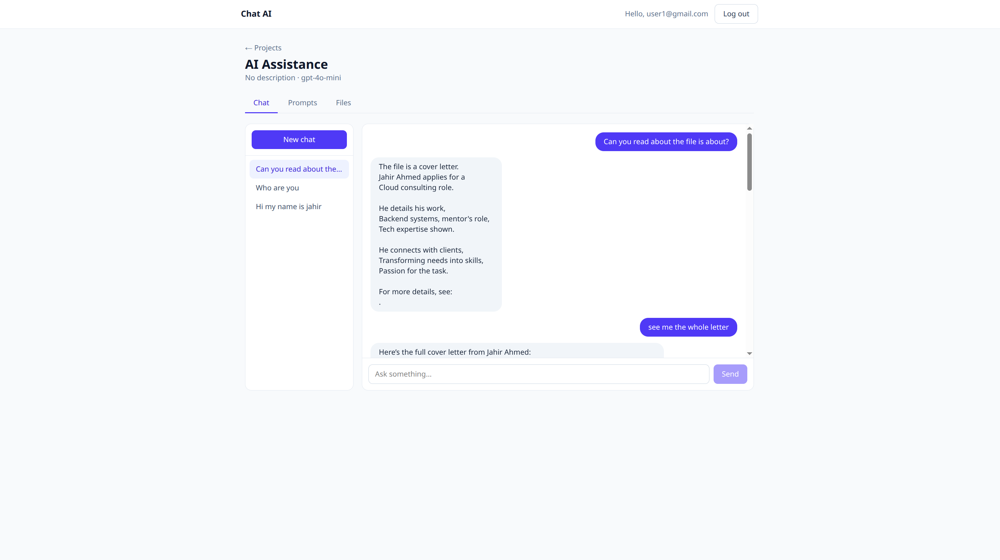
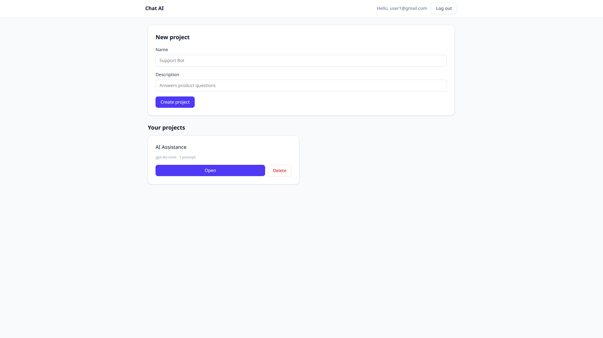
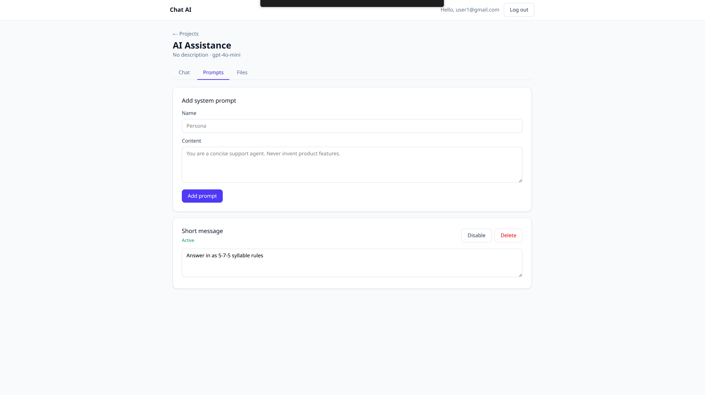
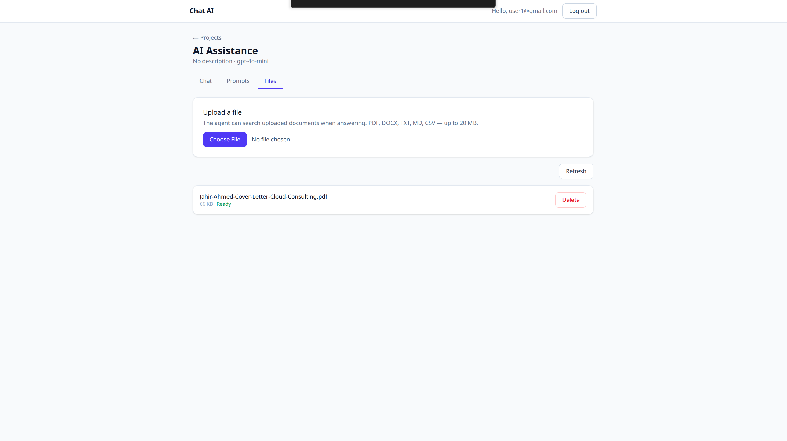
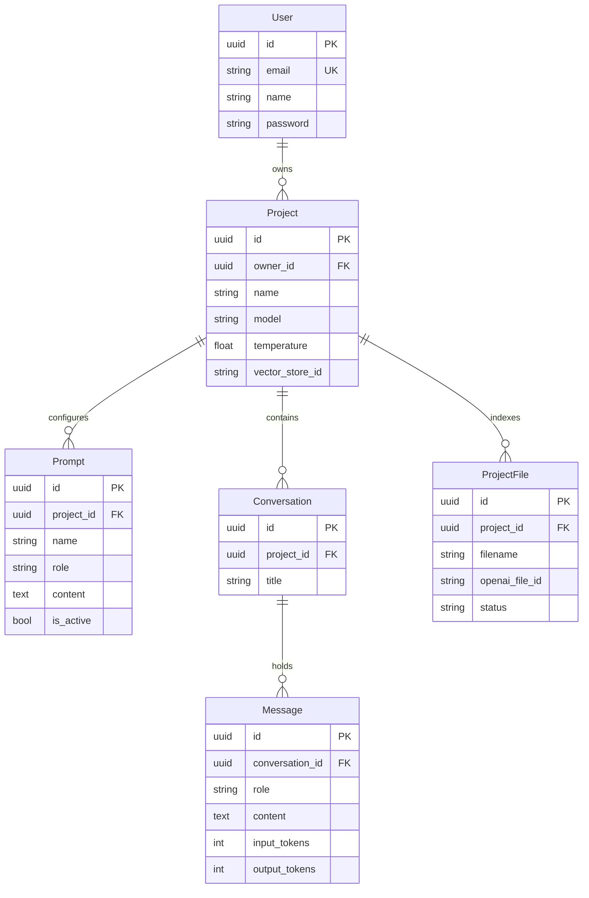

# ChatAI

A multi-tenant chatbot platform. Create AI agents, give them instructions and documents, and chat with them.

[](https://www.djangoproject.com/)
[](https://www.django-rest-framework.org/)
[](https://react.dev/)
[](https://tailwindcss.com/)
[](https://www.postgresql.org/)
[](https://docs.docker.com/compose/)
[](https://platform.openai.com/docs/api-reference/responses)

**[Live demo](https://chat-ai.jahirahmed.com)** · **[API docs](https://chat-ai.jahirahmed.com/api/docs/)** · **[Setup guide](INSTALLATION.md)** · **[Demo video](https://github.com/Jahir509/chat-ai/raw/main/video/demo-video.mp4)**



<p>
  
  
  
</p>

---

## What it does

1. **Create a project.** Each project is an agent with its own model and temperature.
2. **Write its system prompts.** Add as many as you like and switch each one on or off.
3. **Upload documents (optional).** The agent searches them when it answers.
4. **Chat.** Conversations are saved, and you can keep several per project.

Every user's projects, prompts, documents and chats are private to them.

## Try it

- **Live demo:** [chat-ai.jahirahmed.com](https://chat-ai.jahirahmed.com). Sign-up is closed at the moment, so you'll need an account from me; [get in touch](https://jahirahmed.com).
- **On your own machine:** about five minutes with Docker. See the quick start below.

## Quick start

You need Docker and an OpenAI API key.

```bash
git clone https://github.com/Jahir509/chat-ai.git
cd chat-ai
cp backend/.env.example .env.development   # then fill in the development values from INSTALLATION.md (Option A)
docker compose --env-file .env.development up -d --build
docker compose --env-file .env.development exec backend python manage.py createsuperuser
```

Open <http://localhost:8080> and sign in with the account you just created.
For running without Docker, production deployment and troubleshooting, see **[INSTALLATION.md](INSTALLATION.md)**.

---

## Features

- **Accounts:** sign in with email and password. Passwords are hashed with Argon2; refresh tokens rotate and are blacklisted after use.
- **Projects (agents):** create, edit and delete them, each with its own model and temperature. Names are unique per user.
- **Prompts:** several named system prompts per project, each with an on/off switch. The active ones are combined into the model's instructions.
- **Chat:** several conversations per project, all saved. The model sees the last 20 messages, and each reply records its token usage.
- **Documents:** upload files up to 20 MB (PDF, DOCX, TXT, MD, CSV and more). They go into a vector store for that project, and the agent searches it with OpenAI's `file_search` tool.
- **Privacy between users:** another user's data always returns `404`, never `403`, so IDs can't be probed.
- **API docs:** Swagger UI and ReDoc, generated from the code. You can sign in and call any endpoint from the browser.
- **Deployment:** one Docker Compose command, standalone or behind an existing nginx.

## How it works


There are three containers behind one address. Caddy serves the React app and forwards API requests to Django, so the browser talks to a single host and CORS never comes up in production. In production the stack listens on `127.0.0.1` only, so it can sit behind an nginx that already owns ports 80 and 443.

**What happens when you send a message** (`POST /api/conversations/{id}/messages/`):

1. Find the conversation among the caller's own; anything else is a `404`.
2. Combine the project's active system prompts into one instructions string.
3. Load the newest 20 messages with a SQL `LIMIT`, then put them back in order.
4. **Save the user's message**, before calling the model.
5. Call OpenAI with the instructions and history, adding `file_search` if the project has documents.
6. Save the reply with its token counts.
7. Return both messages.

## Tech stack

| Layer | Choice | Why |
|---|---|---|
| API | Django 5.2 + Django REST Framework | Auth, admin and migrations built in; DRF generic views keep the CRUD code small |
| Auth | `djangorestframework-simplejwt` | Stateless tokens, so backend containers can scale without a shared session store |
| Database | PostgreSQL 16 | Real constraints and native UUIDs |
| Model | OpenAI Responses API | Current endpoint with built-in tools; wrapped in one module so it can be swapped |
| Retrieval | OpenAI vector stores + `file_search` | Chunking and embeddings are managed, so there is no vector database to run |
| API docs | `drf-spectacular` | Generated from the serializers, so the docs can't drift from the code |
| Frontend | React 19 + Vite, Tailwind CSS 4 | Fast development loop and a small static build |
| HTTP client | axios | An interceptor refreshes an expired token and replays the request |
| Serving | Caddy, inside the frontend container | Serves the app and proxies the API from a few lines of config |
| App server | gunicorn with `gthread` workers | Threads wait on the network cheaply, which suits an app that mostly waits on OpenAI |

## Design decisions

**Chat history lives in PostgreSQL, not at OpenAI.** Requests are sent with `store=false`, and history is replayed from the database. The database stays the only source of truth, nothing breaks when a stored response expires, switching providers touches one module, and OpenAI keeps no conversation content. Billing is the same either way.

**Only the last 20 messages go to the model.** Every turn re-sends the history, so without a limit, cost and response time would grow with the length of a chat. A SQL `LIMIT` keeps the query cheap too.

**The OpenAI call runs outside any database transaction.** A reply takes seconds. Holding a transaction open that long would use up the connection pool under load. The user's message is saved first, so a failed reply never loses it.

**Document status is checked when you look, not by a background worker.** Indexing on OpenAI's side happens in the background. Rather than add Redis and Celery for one job, the file list refreshes any file still marked pending, and a file stuck for more than five minutes is marked failed so the page never polls forever. Celery is the upgrade path if uploads become heavy.

**Another user's data returns `404`, not `403`.** Every query is filtered by owner before an ID is looked up, so another user's object simply isn't there. A `403` would confirm that it exists. It also means no individual view can forget the ownership check.

**Duplicate project names are caught twice.** The serializer turns a duplicate into a readable `400`, and the database constraint still guarantees uniqueness when two requests arrive at once. Without the serializer check, a duplicate would surface as a `500`.

**Gunicorn uses threads and a 120-second timeout.** Gunicorn's default 30 seconds would kill a slow model reply and return a bare `502`. With `gthread` workers, 3 workers × 4 threads handle 12 chats at once on a small server.

**File-status polling stops on its own.** The browser schedules the next check only after a response that still shows a file indexing, with a cap on attempts. An earlier version used `setInterval` inside an effect, which started an extra timer on every refetch.

## Production details

**Security:** Argon2 password hashing, rotating and blacklistable refresh tokens, owner-scoped queries everywhere, the OpenAI key kept on the server, rate limits (20 requests per minute signed out, 120 signed in), file type and size checked before anything is sent to OpenAI, `nosniff` and `X-Frame-Options: DENY` headers, containers running as a non-root user, and a database that isn't exposed outside Docker.

**Reliability:** a 60-second timeout with up to 2 retries on every OpenAI call, temporary OpenAI failures returned as a clear `503`, user messages saved before the model call, document indexing that always reaches a final status, a database health check that gates backend startup, `restart: unless-stopped` on every container, and best-effort cleanup on OpenAI so an error there can't leave a row you can't delete.

**Performance and scale:** stateless auth so backend containers can scale out, persistent database connections, one OpenAI client per process (no new TLS handshake per request), paginated list endpoints, an index on `(conversation, created_at)` for the query behind every chat message, instant display of sent messages, and gzip for the frontend files.

## Known limitations

| Limitation | Planned fix |
|---|---|
| Replies aren't streamed, so you wait for the whole answer | Stream the reply with server-sent events |
| Behind a CDN with a 100-second limit (such as Cloudflare), a very slow reply can fail with `524` | Streaming, or a longer proxy timeout |
| After a reload, a long conversation shows only its first 20 messages | Load the newest messages first, with a "load earlier" button |
| Deleting a project leaves its vector store and files on OpenAI | Delete them after the project is deleted |
| Document status is refreshed when the file list is viewed, not by a worker | Celery and Redis, if uploads become heavy (a deliberate trade-off for now) |
| No automated tests yet | pytest-django covering sign-in, privacy between users, and a mocked model |
| Single region, with no CDN for uploaded content | Object storage with a CDN; managed PostgreSQL with read replicas |

---

## Reference

<details>
<summary><b>API endpoints</b></summary>

Interactive docs: **`/api/docs/`** (Swagger UI) and **`/api/redoc/`**. Machine-readable schema: `/api/schema/`.

| Method | Path | What it does |
|---|---|---|
| `POST` | `/api/auth/login/` | Email and password in, access and refresh tokens out |
| `POST` | `/api/auth/refresh/` | Swap a refresh token for a new pair |
| `POST` | `/api/auth/logout/` | Blacklist a refresh token |
| `GET` `PATCH` | `/api/auth/me/` | The signed-in user |
| `POST` | `/api/auth/register/` | Create an account *(currently turned off)* |
| `GET` `POST` | `/api/projects/` | List or create projects |
| `GET` `PUT` `PATCH` `DELETE` | `/api/projects/{id}/` | One project |
| `GET` `POST` | `/api/projects/{id}/prompts/` | List or add prompts |
| `GET` `PUT` `PATCH` `DELETE` | `/api/projects/{id}/prompts/{prompt_id}/` | One prompt |
| `GET` `POST` | `/api/projects/{id}/conversations/` | List or start conversations |
| `GET` `DELETE` | `/api/conversations/{id}/` | One conversation |
| `GET` | `/api/conversations/{id}/messages/` | Conversation history |
| `POST` | `/api/conversations/{id}/messages/` | **Send a message and get the agent's reply** |
| `GET` `POST` | `/api/projects/{id}/files/` | List files, or upload one (`multipart/form-data`) |
| `DELETE` | `/api/projects/{id}/files/{file_id}/` | Remove a file here and on OpenAI |

</details>

<details>
<summary><b>Example: the full flow with curl</b></summary>

```bash
BASE=http://localhost:8080/api

# 1. Sign in (sign-up is off, so create the account with createsuperuser or in /admin/)
TOKEN=$(curl -s -X POST $BASE/auth/login/ \
  -H 'Content-Type: application/json' \
  -d '{"email":"me@example.com","password":"your-password"}' \
  | python3 -c 'import sys,json; print(json.load(sys.stdin)["access"])')

# 2. Create a project
PID=$(curl -s -X POST $BASE/projects/ \
  -H "Authorization: Bearer $TOKEN" -H 'Content-Type: application/json' \
  -d '{"name":"Support Bot","description":"Answers product questions"}' \
  | python3 -c 'import sys,json; print(json.load(sys.stdin)["id"])')

# 3. Give it a persona
curl -s -X POST $BASE/projects/$PID/prompts/ \
  -H "Authorization: Bearer $TOKEN" -H 'Content-Type: application/json' \
  -d '{"name":"Persona","role":"system","content":"You are a concise support agent."}'

# 4. Start a conversation
CID=$(curl -s -X POST $BASE/projects/$PID/conversations/ \
  -H "Authorization: Bearer $TOKEN" -H 'Content-Type: application/json' -d '{}' \
  | python3 -c 'import sys,json; print(json.load(sys.stdin)["id"])')

# 5. Talk to it
curl -s -X POST $BASE/conversations/$CID/messages/ \
  -H "Authorization: Bearer $TOKEN" -H 'Content-Type: application/json' \
  -d '{"content":"How do I reset my password?"}'
```

</details>

<details>
<summary><b>Data model</b></summary>



- **Prompts are rows, not one text field on the project.** That is what lets each one be switched on and off, and it leaves room for versioning without a migration.
- **IDs are UUIDs everywhere.** They appear in URLs, and sequential numbers would reveal how much data there is and invite guessing.

</details>

<details>
<summary><b>Project structure</b></summary>

```
chat-ai/
├── backend/
│   ├── config/            settings, root URLs, WSGI
│   ├── apps/
│   │   ├── users/         custom user model, sign-in endpoints
│   │   ├── projects/      projects and prompts
│   │   ├── chat/          conversations, messages, the chat endpoint
│   │   ├── files/         uploads and vector-store attachment
│   │   └── llm/           OpenAI client (the only module that knows the vendor)
│   ├── .env.example       configuration template
│   ├── entrypoint.sh      migrate, collectstatic, then start gunicorn
│   ├── requirements.txt
│   └── Dockerfile
├── frontend/
│   ├── src/
│   │   ├── api/client.js  axios instance with token refresh
│   │   ├── auth/          sign-in state
│   │   ├── components/    Layout, ChatPanel, PromptsPanel, FilesPanel
│   │   ├── pages/         Login, Register, Projects, ProjectDetail
│   │   └── ui.jsx         small styling components
│   ├── Caddyfile          serves the app and proxies the API
│   └── Dockerfile         builds with Node, serves with Caddy
├── images/                screenshots
├── video/                 demo video
├── docker-compose.yml
├── INSTALLATION.md
└── README.md
```

</details>

---

Built with Django REST Framework, React and the OpenAI Responses API.
