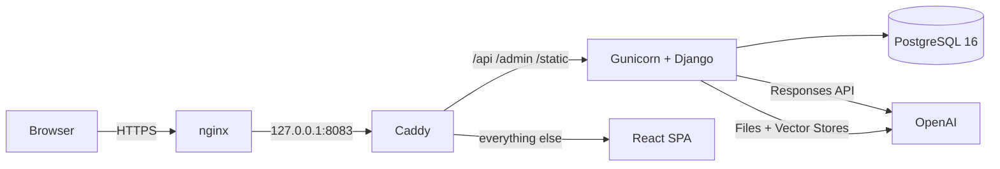
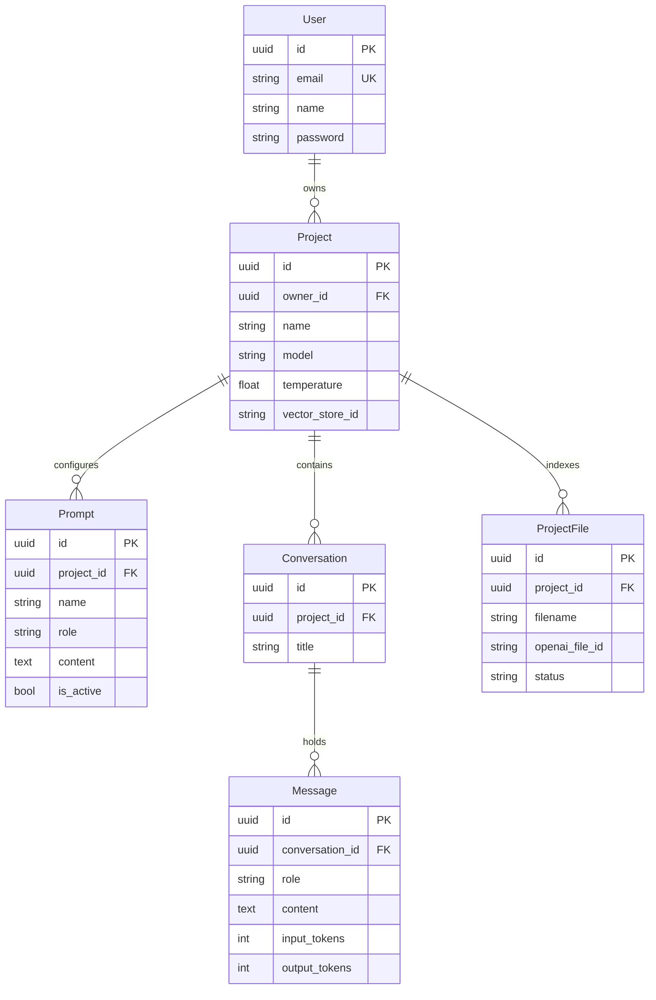

<div align="center">

# ChatAI

**A multi-tenant chatbot platform. Create agents, give them instructions and documents, and talk to them.**

[](https://www.djangoproject.com/)
[](https://www.django-rest-framework.org/)
[](https://react.dev/)
[](https://tailwindcss.com/)
[](https://www.postgresql.org/)
[](https://docs.docker.com/compose/)
[](https://platform.openai.com/docs/api-reference/responses)

[**Live demo**](https://chat-ai.jahirahmed.com) · [**API docs**](https://chat-ai.jahirahmed.com/api/docs/) · [**Setup guide**](./INSTALLATION.md) · [**Demo video**](https://github.com/Jahir509/chat-ai/raw/main/video/demo-video.mp4)

</div>

---

## What it is

ChatAI lets a user register, create any number of **projects** (agents), configure each one with **system prompts**, optionally upload **documents** the agent can search, and hold **conversations** with it. Every project is isolated to its owner at the query layer, the prompt layer, and the retrieval layer.

```
Register → Create a project → Write its prompts → Upload documents → Chat
```

<div align="center">


</div>

### Try it

| | |
|---|---|
| **URL** | https://chat-ai.jahirahmed.com |
| **Sign up** | Registration is open — create an account in a few seconds |
| **API docs** | https://chat-ai.jahirahmed.com/api/docs/ |

Running it yourself takes about five minutes — see **[INSTALLATION.md](./INSTALLATION.md)**.

---

## Contents

- [Features](#features)
- [Architecture](#architecture)
- [Tech stack](#tech-stack)
- [Data model](#data-model)
- [API reference](#api-reference)
- [Design decisions](#design-decisions)
- [Non-functional requirements](#non-functional-requirements)
- [Known limitations](#known-limitations)
- [Project structure](#project-structure)

---

## Features

| | Feature | Notes |
|---|---|---|
| ✅ | **JWT authentication** | Register, login, refresh, logout. 15-minute access tokens, 7-day rotating refresh tokens with blacklist-after-rotation. |
| ✅ | **Email-based accounts** | Custom user model, UUID primary keys, Argon2 password hashing, Django's password validators. |
| ✅ | **Projects / agents** | Full CRUD. Per-project model selection and temperature. Unique name per owner. |
| ✅ | **Prompt management** | Multiple named system prompts per project, individually toggleable. Active prompts are concatenated into the model's instructions at request time. |
| ✅ | **Chat interface** | Multi-conversation, persisted history, windowed context, token accounting, optimistic UI. |
| ✅ | **Document upload** | Files go to the OpenAI Files API and into a per-project vector store; the agent searches them via the `file_search` tool. |
| ✅ | **Interactive API docs** | OpenAPI 3 schema with Swagger UI and ReDoc, JWT-aware so you can exercise every endpoint from the browser. |
| ✅ | **Tenant isolation** | Every queryset is scoped to `request.user`. Cross-tenant reads return `404`, never `403`, so IDs can't be enumerated. |
| ✅ | **One-command deploy** | Docker Compose, deployable standalone or behind an existing nginx. |

---

## Architecture



Three containers, one origin. Caddy serves the compiled React bundle and reverse-proxies API paths to gunicorn, so the browser only ever talks to one host and CORS never enters the picture in production. The stack binds to loopback only, which lets it sit behind an existing nginx on a shared server without competing for ports 80 and 443.

**Request path for a chat message:**

```
POST /api/conversations/{id}/messages/
  │
  ├─ 1. Resolve conversation, scoped to project__owner=request.user   → 404 if not yours
  ├─ 2. Collect active system prompts → single instructions string
  ├─ 3. Load the newest 20 messages (SQL LIMIT), reversed to chronological order
  ├─ 4. Persist the user's message                                    ← committed before the API call
  ├─ 5. Call OpenAI: instructions + history + file_search tool (if the project has files)
  ├─ 6. Persist the assistant's reply with token counts
  └─ 7. Return both rows
```

Step 4 before step 5 is deliberate: the user's message survives an upstream failure, so a retry never means retyping. The OpenAI call sits **outside** any database transaction, because holding a connection open for several seconds of network wait is how connection pools get exhausted.

---

## Tech stack

| Layer | Choice | Why |
|---|---|---|
| API | Django 5.2 + DRF | Batteries-included auth, admin, and migrations; DRF generics keep the CRUD surface tiny. |
| Auth | `djangorestframework-simplejwt` | Stateless tokens → horizontally scalable with no shared session store. |
| Database | PostgreSQL 16 | Real constraints, UUID support, and JSON if the schema needs to flex later. |
| LLM | OpenAI Responses API | Current-generation endpoint with native tool support; wrapped behind a single module so it's swappable. |
| Retrieval | OpenAI vector stores + `file_search` | Managed chunking and embeddings — no vector database to operate. |
| Docs | `drf-spectacular` | Schema generated from the serializers, so it can't drift from the code. |
| Frontend | React 19 + Vite | Fast dev loop, tiny static output. |
| Styling | Tailwind CSS 4 | Utility-first; five hand-rolled primitives instead of a component library. |
| HTTP client | axios | Interceptors make transparent token refresh a dozen lines. |
| Serving | Caddy (in-container) | Static files plus API proxy from a five-line config. |
| WSGI | gunicorn (`gthread`) | Threads block cheaply on network I/O — the right worker model for an LLM proxy. |

---

## Data model



Two schema choices worth calling out:

- **Prompts are rows, not a text column on `Project`.** That's what makes them individually toggleable, and it leaves room for versioning or A/B testing without a migration.
- **UUID primary keys throughout.** Project and conversation IDs appear in URLs; sequential integers would leak volume and invite enumeration.

---

## API reference

Full interactive documentation at **`/api/docs/`** (Swagger UI) and **`/api/redoc/`**. Machine-readable schema at `/api/schema/`.

### Auth

| Method | Path | Description |
|---|---|---|
| `POST` | `/api/auth/register/` | Create an account; returns the user plus both tokens |
| `POST` | `/api/auth/login/` | Email + password → access and refresh tokens |
| `POST` | `/api/auth/refresh/` | Rotate the refresh token, get a new access token |
| `POST` | `/api/auth/logout/` | Blacklist a refresh token |
| `GET` `PATCH` | `/api/auth/me/` | Current user |

### Projects and prompts

| Method | Path | Description |
|---|---|---|
| `GET` `POST` | `/api/projects/` | List or create projects |
| `GET` `PUT` `PATCH` `DELETE` | `/api/projects/{id}/` | Retrieve, update, or delete |
| `GET` `POST` | `/api/projects/{id}/prompts/` | List or add prompts |
| `GET` `PUT` `PATCH` `DELETE` | `/api/projects/{id}/prompts/{prompt_id}/` | Manage one prompt |

### Chat

| Method | Path | Description |
|---|---|---|
| `GET` `POST` | `/api/projects/{id}/conversations/` | List or start conversations |
| `GET` `DELETE` | `/api/conversations/{id}/` | Retrieve or delete a conversation |
| `GET` | `/api/conversations/{id}/messages/` | Conversation history |
| `POST` | `/api/conversations/{id}/messages/` | **Send a message, get the agent's reply** |

### Files

| Method | Path | Description |
|---|---|---|
| `GET` `POST` | `/api/projects/{id}/files/` | List files, or upload one (`multipart/form-data`) |
| `DELETE` | `/api/projects/{id}/files/{file_id}/` | Remove locally and from OpenAI |

<details>
<summary><strong>Example: full flow with curl</strong></summary>

```bash
BASE=https://chat-ai.jahirahmed.com/api

# 1. Register
TOKEN=$(curl -s -X POST $BASE/auth/register/ \
  -H 'Content-Type: application/json' \
  -d '{"email":"me@example.com","name":"Me","password":"Str0ng-Pass-42"}' \
  | python3 -c 'import sys,json; print(json.load(sys.stdin)["access"])')

# 2. Create a project
PID=$(curl -s -X POST $BASE/projects/ \
  -H "Authorization: Bearer $TOKEN" -H 'Content-Type: application/json' \
  -d '{"name":"Support Bot","description":"Answers product questions"}' \
  | python3 -c 'import sys,json; print(json.load(sys.stdin)["id"])')

# 3. Give it a persona
curl -s -X POST $BASE/projects/$PID/prompts/ \
  -H "Authorization: Bearer $TOKEN" -H 'Content-Type: application/json' \
  -d '{"name":"Persona","role":"system","content":"You are a concise support agent."}'

# 4. Start a conversation
CID=$(curl -s -X POST $BASE/projects/$PID/conversations/ \
  -H "Authorization: Bearer $TOKEN" -H 'Content-Type: application/json' -d '{}' \
  | python3 -c 'import sys,json; print(json.load(sys.stdin)["id"])')

# 5. Talk to it
curl -s -X POST $BASE/conversations/$CID/messages/ \
  -H "Authorization: Bearer $TOKEN" -H 'Content-Type: application/json' \
  -d '{"content":"How do I reset my password?"}'
```

</details>

---

## Design decisions

The choices below are the ones a reader is most likely to question, with the reasoning behind each.

<details open>
<summary><strong>Conversation state lives in PostgreSQL, not OpenAI</strong></summary>

The Responses API can maintain state server-side via `previous_response_id`. This project sends `store=false` and replays history from its own database instead.

- PostgreSQL stays the single source of truth — nothing breaks when a stored response expires
- Swapping providers touches one module, not the data model
- No conversation content is retained by the vendor
- Billing is unchanged either way: prior input tokens are charged on every turn regardless

</details>

<details>
<summary><strong>History is windowed to the last 20 messages</strong></summary>

Every turn re-sends prior messages, so unbounded history means costs and latency that grow linearly with conversation length. The window is applied as a SQL `LIMIT` on `-created_at` and then reversed, so the query stays cheap and the model always receives the *most recent* context in chronological order.

</details>

<details>
<summary><strong>The OpenAI call is outside any database transaction</strong></summary>

An LLM request blocks for seconds. Wrapping it in `transaction.atomic()` would hold a Postgres connection open for that entire time, and under concurrency the pool would exhaust long before CPU or memory did. The user's message is committed first, then the API call runs, then the reply is committed — which also means an upstream failure never loses what the user typed.

</details>

<details>
<summary><strong>File indexing status is refreshed on read, with a stale guard</strong></summary>

Attaching a file to a vector store is asynchronous, so the upload endpoint returns a provisional `in_progress`. Rather than introduce Redis and Celery for one background job, the list endpoint refreshes any row still marked pending, and the frontend polls only while at least one file is pending.

The important detail is the **stale guard**: if a file has been `in_progress` for more than five minutes, it is marked `failed`. Without a guaranteed terminal state, an upstream error leaves the row pending forever and the client polls indefinitely. Celery is the natural upgrade if uploads grow heavy.

</details>

<details>
<summary><strong>Polling is a chain of timeouts, not an interval on a state dependency</strong></summary>

The client schedules the next status check only after a response that still shows work pending, with an attempt cap and a run counter that invalidates superseded chains. An earlier version used `setInterval` inside an effect that depended on the fetched array — every refetch produced a new array identity, restarting the effect and stacking timers. Depending on derived booleans rather than object identity is the general fix.

</details>

<details>
<summary><strong>Uniqueness is validated in the serializer <em>and</em> the database</strong></summary>

`Project` has a `UniqueConstraint` on `(owner, name)`, but `owner` isn't a serializer field, so DRF cannot generate the validator automatically. Without an explicit `validate_name`, a duplicate produces an `IntegrityError` and a 500. The serializer check makes the common case a readable 400; the database constraint remains the correctness guarantee under concurrent writes.

</details>

<details>
<summary><strong>Cross-tenant access returns 404, not 403</strong></summary>

Every view narrows its queryset by owner before looking up an ID, so a foreign object simply isn't in the result set. A 403 would confirm the resource exists and let an attacker enumerate valid IDs; a 404 reveals nothing. This also means ownership checks can't be forgotten in individual handlers — the queryset is the boundary.

</details>

<details>
<summary><strong>Gunicorn's timeout is raised to 120 seconds</strong></summary>

The default is 30, and gunicorn kills any worker that exceeds it. A slow model reply would return a bare 502 with nothing useful in the logs — the most common way an LLM application works in development and fails in production. Every proxy in front of it is configured to match. Paired with `gthread` workers, since threads block cheaply on network I/O: 3 workers × 4 threads serves 12 concurrent chat requests on a modest VPS.

</details>

<details>
<summary><strong>Five styling primitives instead of a component library</strong></summary>

`Button`, `Input`, `Textarea`, `Card`, `Spinner` — about 60 lines total. That is less code than configuring a component library's theme, ships nothing unused, and avoids the reset-vs-Preflight conflicts that come from mixing a CSS framework with a styled component kit.

</details>

---

## Non-functional requirements

| Requirement | How it's addressed |
|---|---|
| **Scalability** | Stateless JWT auth — no shared session store, so backend containers scale horizontally. Threaded workers for I/O-bound LLM calls. Paginated list endpoints. Composite index on `(conversation, created_at)`, the query on every chat request. Connection reuse via `CONN_MAX_AGE`. |
| **Security** | Argon2 hashing. Short access tokens with rotating, blacklistable refresh tokens. Per-object ownership scoping on every queryset. API keys server-side only. Request throttling (20/min anonymous, 120/min authenticated). Upload type and size validation before bytes leave the server. HSTS, secure cookies, `nosniff`, `X-Frame-Options: DENY` when running over HTTPS. Non-root container user. Database not exposed to the host network. |
| **Extensibility** | The LLM integration is one module behind a narrow interface — provider swaps don't touch views or models. Prompts are rows, so versioning and analytics need no schema change. Apps are split by domain (`users`, `projects`, `chat`, `files`). OpenAPI schema generated from code, ready for typed client generation. |
| **Performance** | Connection pooling and a process-level OpenAI client, so no TLS handshake per request. Windowed history keeps token counts flat as conversations grow. Optimistic UI updates make sends and deletes feel instant. Gzip compression and long-lived caching on static assets. |
| **Reliability** | Timeouts and bounded retries on every upstream call, with transient failures mapped to a clean `503` and a readable message. User messages persisted before the API call, so failures never lose input. Guaranteed terminal state for async file indexing. Database `healthcheck` gates backend startup. `restart: unless-stopped` on every container. Structured logging of upstream failures. Best-effort remote cleanup so a vendor-side error can't create an undeletable local row. |


---

## Known limitations

Stated plainly, with the fix in each case:

| Limitation | Fix |
|---|---|
| Replies are not streamed, so time-to-first-token equals full generation time | Return `StreamingHttpResponse` over SSE from the message endpoint; the architecture is otherwise unchanged |
| Deleting a project leaves its vector store and files on OpenAI | A `pre_delete` signal calling the cleanup helpers |
| Message history is paginated at 20, so long conversations look truncated in the UI even though the model still receives recent context | `pagination_class = None` on the message view, or cursor pagination |
| File indexing status is refreshed on read rather than by a worker | Celery + Redis, with a webhook or periodic task |
| Behind a CDN with a 100s proxy timeout, a very slow reply can return 524 even though gunicorn allows 120s | Stream the response, or raise the proxy timeout |
| No automated test suite | pytest-django covering auth flows, tenant isolation, and a mocked LLM client |
| Single-region deployment, no CDN for user content | Object storage plus a CDN; managed Postgres with read replicas |

---

## Project structure

```
chat-ai/
├── backend/
│   ├── config/                 settings, root urls, wsgi
│   ├── apps/
│   │   ├── users/              custom user, JWT auth endpoints
│   │   ├── projects/           Project and Prompt
│   │   ├── chat/               Conversation, Message, chat endpoint
│   │   ├── files/              uploads, vector-store attachment
│   │   └── llm/                OpenAI client wrapper (the only vendor-aware module)
│   ├── entrypoint.sh           migrate → collectstatic → gunicorn
│   ├── requirements.txt
│   └── Dockerfile
├── frontend/
│   ├── src/
│   │   ├── api/client.js       axios instance, token refresh interceptor
│   │   ├── auth/AuthContext.jsx
│   │   ├── components/         Layout, ChatPanel, PromptsPanel, FilesPanel
│   │   ├── pages/              Login, Register, Projects, ProjectDetail
│   │   └── ui.jsx              styling primitives
│   ├── Caddyfile               static serving + API reverse proxy
│   └── Dockerfile              multi-stage: node build → caddy
├── docker-compose.yml
├── .env.example
├── INSTALLATION.md
└── README.md
```

---

<div align="center">

Built with Django REST Framework, React, and the OpenAI Responses API.

</div>
